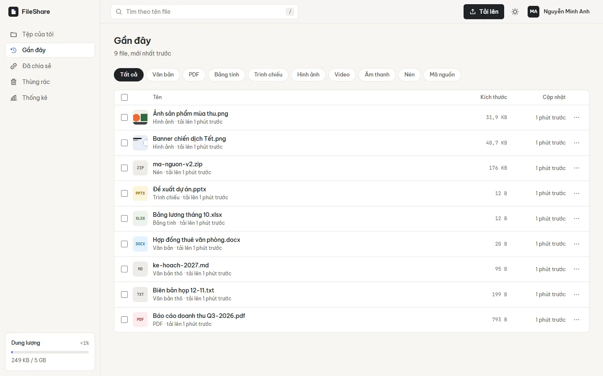

# FileShare

Ứng dụng web lưu trữ và chia sẻ tài liệu: file riêng tư theo mặc định, chia sẻ bằng link có mật khẩu, hạn dùng và giới hạn lượt tải.



## Tính năng

**Quản lý file**
- Thư mục lồng nhau, đổi tên, di chuyển (kể cả hàng loạt), tìm kiếm tiếng Việt, lọc theo loại file
- Tải lên nhiều file cùng lúc bằng nút bấm hoặc kéo thả, có tiến trình từng file, huỷ và thử lại
- Xem trước ảnh, PDF, video, âm thanh, văn bản và mã nguồn ngay trên trình duyệt; ảnh có thumbnail WebP
- Thùng rác: xoá cả thư mục cùng nội dung, khôi phục nguyên vẹn, tự dọn sau 30 ngày

**Chia sẻ**
- Mỗi file có nhiều link, mỗi link chọn rõ **Riêng tư** (bắt buộc mật khẩu) hoặc **Công khai** (ai có link cũng mở được), cùng hạn dùng và số lượt tải riêng
- Thống kê lượt xem và lượt tải từng link, thu hồi link ngay lập tức
- Trang nhận file công khai, người nhận không cần tài khoản

**Tài khoản và quản trị**
- Hạn mức dung lượng cho từng người (mặc định 2 GB), file trong thùng rác vẫn được tính
- Trang thống kê: hoạt động 30 ngày, dung lượng theo loại file, file được tải nhiều nhất
- Trang quản trị: tìm người dùng, đổi hạn mức, cấp quyền, khoá hoặc xoá tài khoản
- Giao diện sáng, tối hoặc theo hệ thống; dùng tốt trên điện thoại

## Bảo mật

- Mật khẩu băm bằng bcrypt; access token sống 15 phút, chỉ giữ trong bộ nhớ trình duyệt
- Refresh token nằm trong cookie `httpOnly` + `SameSite=Strict`, xoay vòng sau mỗi lần dùng, DB chỉ lưu hash
- File lưu với tên ngẫu nhiên, không có đường dẫn công khai; nội dung chỉ phục vụ qua signed URL ngắn hạn
- Chỉ hiển thị inline các định dạng an toàn; HTML hiển thị dạng mã nguồn, SVG luôn bị ép tải xuống (chống XSS)
- Giới hạn lượt tải được trừ nguyên tử, không thể vượt kể cả khi tải đồng thời
- Helmet (CSP, nosniff...), giới hạn số lần thử đăng nhập và mở khoá link, escape regex khi tìm kiếm, validate mọi input bằng Zod

## Công nghệ

| | |
|---|---|
| Frontend | React 19, TypeScript, Vite, TanStack Query, React Router, Tailwind CSS 4, Radix UI, Phosphor Icons |
| Backend | Node.js, Express 5, TypeScript, Mongoose (MongoDB), Zod, Multer, Sharp, Pino |
| Kiểm thử | Vitest + Supertest + MongoDB in-memory (API), script E2E trên stack thật, Playwright |

## Chạy thử nhanh (không cần cài MongoDB)

Yêu cầu Node.js 20.19 trở lên.

```bash
npm install
npm run dev:mem
```

Mở http://localhost:5173 và đăng nhập bằng tài khoản demo:

| Email | Mật khẩu | Vai trò |
|---|---|---|
| `demo@fileshare.vn` | `Demo12345` | Người dùng |
| `admin@fileshare.vn` | `Admin12345` | Quản trị |

`dev:mem` khởi động MongoDB nhúng, dữ liệu lưu ở `server/.devdata` nên vẫn còn sau khi khởi động lại.

## Chạy với MongoDB thật

```bash
cp server/.env.example server/.env   # sửa MONGO_URI và JWT_SECRET
npm install
npm run dev                           # API :5000, web :5173
npm run seed -w server                # (tuỳ chọn) tạo tài khoản demo
```

Người đăng ký đầu tiên tự động trở thành quản trị viên.

## Triển khai bằng Docker

```bash
cp .env.example .env    # đặt JWT_SECRET
docker compose up -d --build
```

Mở http://localhost:8080. Image build cả frontend và backend; Express phục vụ luôn giao diện, MongoDB chạy ở container riêng, file tải lên nằm trong volume `uploads`.

Khi đặt sau reverse proxy có HTTPS, đặt `TRUST_PROXY=true` và `CLIENT_ORIGIN` đúng domain.

## Kiểm thử

```bash
npm test                      # 43 test API + unit test frontend
npm run typecheck
npm run dev:mem               # terminal khác
npm run test:e2e              # 17 bước E2E trên stack đang chạy
```

## Cấu trúc

```
server/src
  config/      biến môi trường (validate bằng Zod), kết nối DB
  lib/         lưu trữ file, token, phân loại file, phục vụ file an toàn
  middleware/  xác thực, upload, rate limit, xử lý lỗi
  models/      User, Session, Folder, File, ShareLink, Activity
  modules/     auth, files + folders, trash, shares, media, stats, admin
  services/    nghiệp vụ dùng chung (thùng rác, di chuyển thư mục, thống kê)
server/tests   test tích hợp API
client/src
  components/  UI dùng chung, trình quản lý file, biểu đồ
  layouts/     khung ứng dụng (sidebar, thanh trên)
  lib/         API client, auth, truy vấn, hàng đợi upload, theme
  pages/       các trang
scripts/       e2e-api.mjs
```

## Biến môi trường (server)

| Biến | Mặc định | Ý nghĩa |
|---|---|---|
| `MONGO_URI` | `mongodb://localhost:27017/fileshare` | Kết nối MongoDB |
| `JWT_SECRET` | (bắt buộc, >= 32 ký tự) | Bí mật ký token |
| `UPLOAD_DIR` | `./uploads` | Thư mục lưu file |
| `MAX_FILE_SIZE_MB` | `200` | Giới hạn mỗi file |
| `DEFAULT_QUOTA_MB` | `2048` | Hạn mức mặc định mỗi người |
| `TRASH_RETENTION_DAYS` | `30` | Số ngày giữ trong thùng rác |
| `CLIENT_ORIGIN` | `http://localhost:5173` | Domain frontend (CORS) |
| `TRUST_PROXY` | `false` | Bật khi chạy sau reverse proxy |

## Giấy phép

MIT
